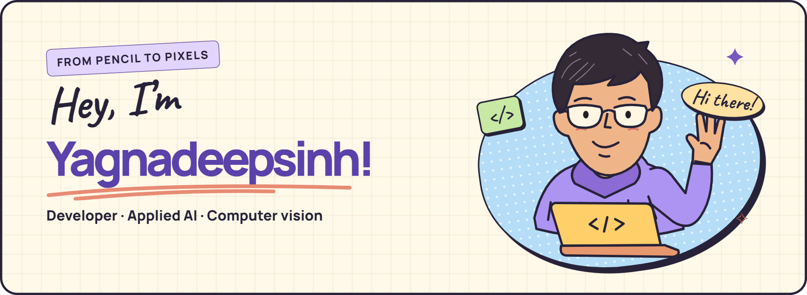
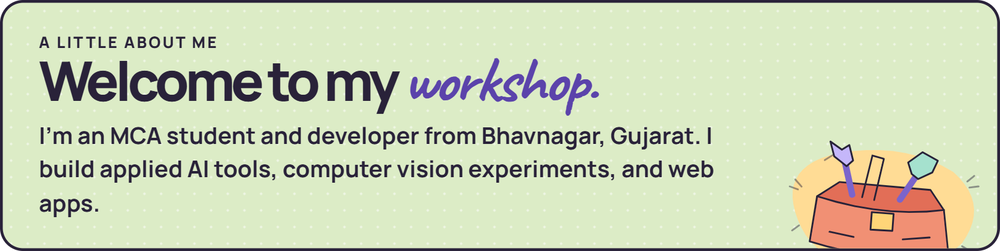
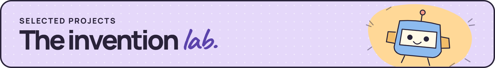
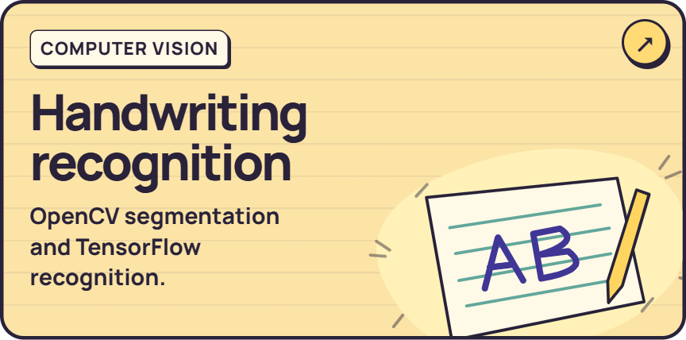
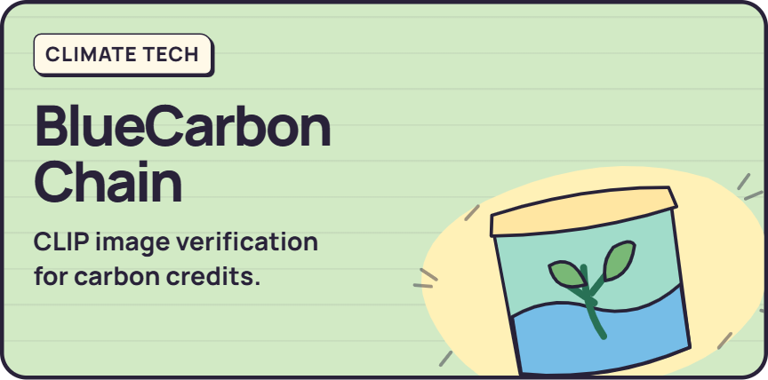
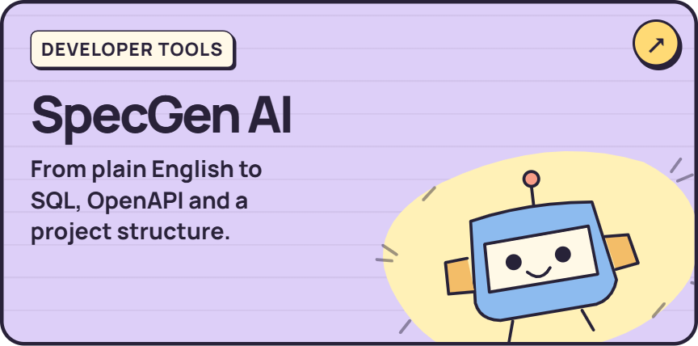
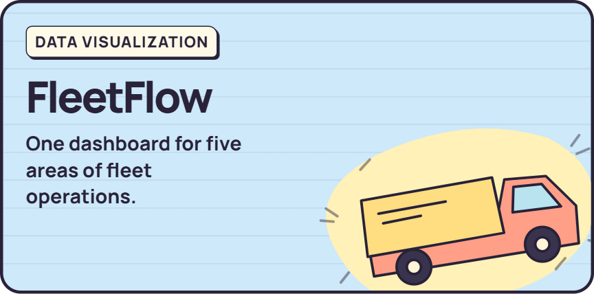
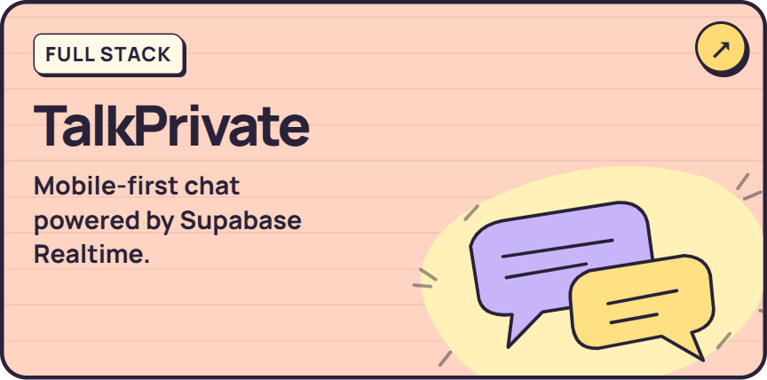
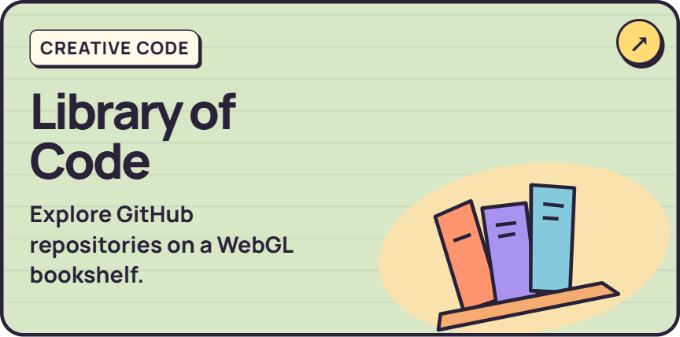
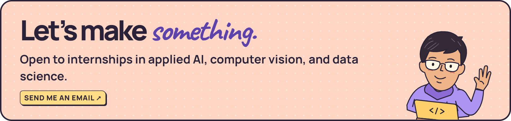

**[Portfolio](https://vaghela-yagnadeepsinh.cv)** · [Invention lab](#the-invention-lab) · [Toolbox](#the-toolbox) · [Milestones](#milestones) · [Contact](#lets-make-something)

Project notes and more from the workshop

- **Handwriting Recognition and Generation** — A desktop app that segments handwritten letters with OpenCV and classifies them with a TensorFlow model.
- **BlueCarbon Chain** — A blue carbon registry with a CLIP-based verifier for field images.
- **SpecGen AI** — Generates a SQL schema, an OpenAPI spec and a starter folder structure from natural-language requirements.
- **FleetFlow** — Built with a four-person team at the Odoo × Gujarat Vidyapith Hackathon.
- **TalkPrivate** — A mobile-first chat app with real-time messages and persistent conversations.
- **Library of Code** — A WebGL bookshelf for exploring GitHub repositories.
- **[Chaotic Chess](https://chessmultiplayer.vercel.app)** — Real-time multiplayer chess with Chess.js and Stockfish analysis.
- **PropertyFinder India** — A land-record search app with adapters for regional data sources.
- **LockUp** — An Android app locker using face recognition and device biometrics.
- **NewsFlash** — A publishing dashboard with PDF generation and sharing tools.
- **Lumière** — A perfume storefront with catalog management, Supabase Storage and a UPI payment flow.
- **Balaji Computer** — A hardware showcase with 3D product interactions.
- **She Can Foundation** — An NGO site with program information, certificates and a donation flow.
- **Devyx** — An agency site built around scroll-driven WebGL scenes.

Toolbox and milestones in text

**Toolbox**

- **Vision and AI** — Python, TensorFlow, OpenCV, CLIP, Gemini and Groq.
- **Web and motion** — TypeScript, React, Next.js, Tailwind CSS, Three.js and GSAP.
- **Backend and delivery** — Node.js, PostgreSQL, Supabase, Docker, AWS and Vercel.
- **Mobile and blockchain** — Kotlin, Flutter, Solidity and Hardhat.

**Milestones**

- **BCA**, Shree Swaminarayan College of Computer Science (MKBU) · 2023–2026.
- **Python intern**, The EasyLearn · January–March 2026.
- **MCA**, Gyanmanjari Innovative University · July 2026–present.
- **Hackathons** — TEXPlode 5.0 winner, Supervity AutoPilot honorable mention, and finalist at AI4Dev, BIOTHON and FAR AWAY.

**[Visit my illustrated portfolio](https://vaghela-yagnadeepsinh.cv)** · [LinkedIn](https://www.linkedin.com/in/vaghelayagnadeepsinh/) · [Email](mailto:yagnadeepsinh.4741@gmail.com)
